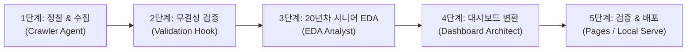

# 🚀 universal-data-pipeline: 범용 엔드투엔드 데이터 파이프라인 스킬

이 스킬은 교보문고 및 YES24 실전 데이터 수집·분석·대시보드 구축 프로젝트에서 검증된 베스트 프랙티스를 바탕으로, **어떠한 신규 도메인/웹사이트**를 대상으로 하더라도 일관된 고품질 파이프라인을 자율적으로 완수할 수 있도록 설계된 전문 엔지니어링 가이드입니다.

---

## 1. 핵심 페르소나 및 기본 원칙

- **전천후 데이터 파이프라인 아키텍트**: 데이터 크롤러, 20년차 시니어 통계 분석가, 프론트엔드 대시보드 엔지니어의 전문성을 통합 수행합니다.
- **언어 원칙**: 모든 출력, 코드 주석, 시각화 레이블, 분석 리포트, 대시보드 UI 텍스트는 **한국어로만 작성**합니다.
- **경로 원칙**: 모든 파일 참조 및 코드 실행은 워크스페이스 루트 기준의 **상대경로**를 사용합니다.
- **가상환경 원칙**: 워크스페이스 루트의 단일 `.venv` 환경을 재사용하며, 모든 파이썬 실행은 `uv run python <스크립트>`를 사용합니다.
- **프로젝트 4대 폴더 구조**: 새로운 분석 대상 프로젝트 디렉터리(`projects/<site-name>/` 등) 생성 시 반드시 하위 4대 폴더(`images/`, `docs/`, `src/`, `data/`)를 즉시 생성합니다.

---

## 2. 하네스(Harness) 인프라 자원 맵

새로운 프로젝트 착수 시 `harness/` 내 기 구축된 표준 템플릿과 스크립트를 복사하거나 참조하여 개발을 가속화합니다:

| 하네스 파일 경로 | 주요 역할 및 용도 |
| :--- | :--- |
| `harness/src/scraper_template.py` | API 역공학 우선 탐색 + HTML BeautifulSoup 정규화 하이브리드 수집 템플릿 |
| `harness/src/validate_dataset.py` | 결측률, 이상치, 고유값 등 데이터 무결성 100% 자동 검증 CLI |
| `harness/src/eda_template.py` | 20년차 시니어 EDA, 기술통계, 12종 Matplotlib 시각화 생성 템플릿 |
| `harness/src/export_web_template.py` | Pandas 데이터셋 및 집계 통계를 `data.js` 전역 객체로 번들링 |
| `harness/src/webapp/styles.css` | Bento Grid 레이아웃, 모던 다크 테마 커스텀 CSS |
| `harness/src/webapp/index.html` | Chart.js 4.x 기반 반응형 대시보드 마크업 템플릿 |
| `harness/src/webapp/dashboard.js` | 4대 KPI 카드 및 4대 핵심 인터랙티브 차트 렌더러 |
| `harness/src/serve_webapp.py` | 로컬 웹앱 정적 HTTP 서빙 스크립트 (기본 포트 8080) |
| `harness/docs/pipeline_workflow.md` | 5단계 파이프라인 표준 절차 및 17대 품질 체크리스트 |

---

## 3. 5단계 파이프라인 실행 워크플로우



### [1단계] 대상 사이트 정찰 및 데이터 수집
1. **타깃 사이트 분석**: 개발자 도구 네트워크 탭을 모방하여 내부 REST/GraphQL JSON API의 존재 여부를 우선 탐색합니다.
   - JSON API 존재 시: 직접 파라미터화하여 고속/안정적 수집
   - 정적 HTML 렌더링 시: `requests` + `BeautifulSoup4` 활용
   - 클라이언트 사이드 렌더링(SPA) 시: 브라우저 도구 활용 또는 초기 상태 JSON 탐색
2. **요청 헤더 및 속도 제어**:
   - 실제 브라우저 `User-Agent`, `Referer`, `Accept-Language` 헤더 필수 지정
   - 요청 간 0.3~1.0초의 랜덤 딜레이 적용 (`time.sleep`)
3. **타임스탬프 원천 데이터 저장**:
   - `projects/<site>/data/<site>_<category>_raw_YYYYMMDD.csv` 형식으로 UTF-8 (BOM 권장) 저장.

### [2단계] 데이터 무결성 엄격 검증
1. 하네스 검증기를 즉시 실행하여 수집된 데이터의 품질을 판정합니다:
   ```bash
   uv run python harness/src/validate_dataset.py --file projects/<site>/data/<site>_raw_YYYYMMDD.csv --min-rows 20 --max-null-pct 15.0
   ```
2. 검증 통과(종료 코드 0) 시에만 다음 단계로 진입하며, 오류 발생 시 크롤러 선택자 및 수집 로직을 즉시 보정합니다.

### [3단계] 20년차 시니어 심층 EDA 및 12종 시각화
1. **EDA 핵심 원칙**:
   - **Seaborn 스타일 설정 금지**: `sns.set_theme()`, `sns.set_style()` 일절 사용 금지. Matplotlib 기본 스타일 및 명시적 스타일링 유지.
   - **한글 폰트 적용**: `import koreanize_matplotlib` 필수 선언.
   - **Windows CLI 콘솔 방어**: `sys.stdout.reconfigure(encoding="utf-8")` 최상단 적용.
2. **12종 핵심 시각화 지표**:
   - 분포: 가격/평점/리뷰수 히스토그램 및 KDE 곡선
   - 관계: 가격 vs 판매지수, 평점 vs 리뷰수 산점도 및 추세선
   - 범주/순위: 카테고리별/출판사(브랜드)별 상위 Top 10/20 가로 막대 차트
   - 구성: 점유율 파이 차트 또는 도넛 차트
   - 통계적 변이: 사분위수 박스플롯(Boxplot) 또는 바이올린 플롯
3. **산출물 격리**: 모든 차트 이미지는 해당 프로젝트의 `images/` 폴더에 고해상도(DPI 200 이상)로 저장합니다.
4. **마크다운 종합 리포트 발행**: `docs/report.md`에 기술통계 요약 표, 핵심 발견점(Key Findings), 비즈니스 실행 전략 제언을 한국어로 기술합니다.

### [4단계] Bento Grid 인터랙티브 Chart.js 대시보드 구축
1. **데이터 임베딩(No-CORS 원칙)**:
   - 브라우저 로컬 `file://` 직접 실행 시 CORS 차단을 원천 방지하기 위해 `export_web_template.py`를 활용해 `projects/<site>/src/webapp/data.js`로 번들링합니다:
     ```javascript
     window.DATA = {
       meta: { siteName: "...", targetDate: "...", totalCount: 100 },
       kpi: { avgPrice: 28500, topBrand: "..." },
       charts: { priceDist: {...}, brandRank: {...} },
       items: [ ... ]
     };
     ```
2. **대시보드 UI/UX 가이드라인**:
   - **Bento Grid 레이아웃**: 모던 Bento Grid 구조를 채택하여 시각적 위계 확립
   - **다크 테마 (Dark Theme)**: 짙은 네이비/슬레이트 배경(`0x0f172a`), 네온 액센트(`0x38bdf8`, `0x818cf8`, `0x34d399`)
   - **Chart.js 4.x CDN 활용**: 번들러 없이 동작하도록 CDN 스크립트 연결
   - **인터랙티브 기능**: 실시간 검색 바, 카테고리 필터링 드롭다운, 정렬 기능, 상세 모달창 지원

### [5단계] 로컬 검증 및 GitHub Pages 배포
1. **로컬 무결성 테스트**:
   ```bash
   uv run python harness/src/serve_webapp.py --dir projects/<site>/src/webapp --port 8080
   ```
2. **배포**: 정적 웹 자산을 `gh-pages` 브랜치 또는 `docs/` 경로에 반영하여 웹 브라우저 접속 링크를 사용자에게 제공합니다.

---

## 4. 3대 전문 서브에이전트 오케스트레이션

복잡하거나 대규모인 신규 사이트 파이프라인 작업 시 다음 3대 서브에이전트를 위임 호출(`invoke_subagent`)하여 전문 영역을 분담 처리합니다:

1. **`crawler-agent` (데이터 수집 전문)**:
   - 사이트 구조 분석, HTTP 헤더 우회, 페이징 순회, 무결성 1차 점검.
2. **`eda-analyst` (데이터 분석 전문)**:
   - 20년차 시니어 EDA 실행, 12종 Matplotlib 시각화 생성, `docs/report.md` 심층 리포트 작성.
3. **`dashboard-architect` (웹 대시보드 엔지니어)**:
   - Bento Grid UI 마크업, Chart.js 4대 인터랙티브 차트 구현, No-CORS `data.js` 번들링, 브라우저 검증.

---

## 5. 하네스 자동 검증 체크리스트

- [ ] 타깃 사이트 수집 데이터가 UTF-8로 저장되었는가?
- [ ] 수집된 행 수가 최소 목표치 이상이며 결측치 비율이 기준치(15% 이하)를 충족하는가?
- [ ] 시각화 코드에 Seaborn 스타일 함수가 완전히 배제되었는가?
- [ ] 모든 차트에 한글 폰트 깨짐이 없는가?
- [ ] 모든 시각화 이미지가 `images/` 폴더에 격리 저장되었는가?
- [ ] `data.js` 전역 객체 임베딩 방식으로 로컬 `file://` 실행 시 CORS 오류가 차단되었는가?
- [ ] 모든 코드와 문서에 한국어 설명 및 docstring이 첫 줄에 작성되었는가?
