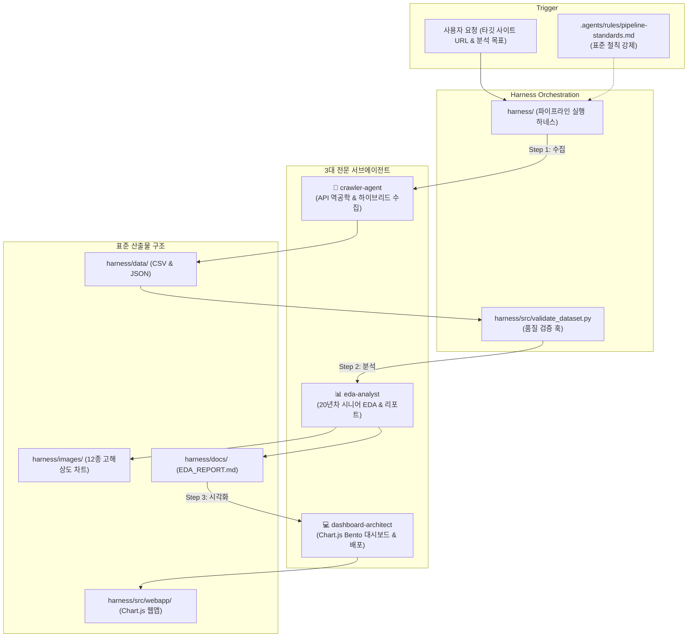

# 📋 [하네스 아티팩트] 범용 데이터 크롤링 · 시니어 EDA · 웹 대시보드 파이프라인 구현 계획서

본 문서는 교보문고 및 YES24 베스트셀러 프로젝트를 통해 검증된 엔지니어링 성공 패턴을 바탕으로, **어떠한 새로운 웹사이트라도 단일 지시로 크롤링 ➡️ 시니어 EDA ➡️ 12종 시각화 & 종합 리포트 ➡️ Chart.js Bento 대시보드 ➡️ GitHub Pages 배포까지 완결**할 수 있는 표준 하네스(Harness) 시스템의 설계 및 실행 명세입니다.

---

## 1. 하네스(Harness) 시스템 아키텍처

---

## 2. 5단계 표준 실행 파이프라인 명세

| 단계 | 명칭 | 사용 템플릿 / 스크립트 | 주관 서브에이전트 | 핵심 산출물 및 기준 |
|:---:|:---|:---|:---:|:---|
| **1단계** | **타깃 역공학 & 하이브리드 수집** | `harness/src/scraper_template.py` | `crawler-agent` | `data/<site>_<topic>_YYYYMMDD.csv` 및 `.json` - 결측치 보정, 지연시간(0.5~1초), 전수 수집 |
| **2단계** | **데이터 무결성 검증 훅** | `harness/src/validate_dataset.py` | Automated Hook | 행/열 수 검증, 중복 0건, 핵심 컬럼 결측률 0% 확인 |
| **3단계** | **20년차 시니어 EDA** | `harness/src/eda_template.py` | `eda-analyst` | 5단계 탐색(`head`, `tail`, `info`, `shape`, `describe`), 10종 통계표 |
| **4단계** | **12종 시각화 & 종합 리포트** | `harness/docs/EDA_REPORT.md` | `eda-analyst` | `images/`에 12종 차트 개별 저장, **각 차트당 300자 이상 통계 해석**, 비즈니스 제언 |
| **5단계** | **Chart.js Bento 웹 대시보드** | `harness/src/webapp/` | `dashboard-architect` | Bento Grid 다크 모드, 5대 KPI, Chart.js 7종, 다차원 실시간 필터, CSV 다운로드, 배포 |

---

## 3. 핵심 엔지니어링 원칙 및 가드레일

1. **가상환경 원칙**: 워크스페이스 루트의 단일 `.venv`를 공통 사용하며 `uv run python`으로만 실행합니다.
2. **시각화 무결성**: Seaborn 전역 스타일(`sns.set_theme()`)을 절대 사용하지 않고 `koreanize-matplotlib`를 사용하여 한글 폰트를 완벽 적용합니다.
3. **해석 전문성**: 모든 시각화 차트에 대해 교차표/피봇테이블을 동반하고, 20년차 시니어 관점의 300자 이상 심층 해석을 필수로 작성합니다.
4. **웹앱 독립성**: `data.js`를 자동 생성하여 로컬 더블클릭(`file://`) 실행 시에도 CORS 제약 없이 동작할 수 있도록 보장합니다.
