# 📊 [쇼케이스 리포트] 글로벌 테크 채용 공고 정밀 EDA 보고서

- **발행일자**: 2026년 10월 13일
- **분석 주관**: EdaAnalyst (20년차 수석 데이터 분석가)
- **분석 대상**: 글로벌 테크 채용 공고 전수 수집 데이터셋 (80건)

---

## 1. 종합 핵심 통계 요약 (Executive Summary)

| 핵심 지표 | 산출 수치 | 통계적 의미 및 비즈니스 해석 |
| :--- | :--- | :--- |
| **전체 유효 공고 수** | **80건** | 결측치 및 중복이 완전히 제거된 정제 데이터 |
| **평균 연봉** | **9,244만원** | 중앙값과 고연봉 AI/LLM 직군에 의한 우상향 분포 |
| **평균 요구 경력** | **6.2년** | 3~7년차 실무 미드레벨 인력 수요 집중 |
| **평균 기업 평점** | **4.23점 / 5.0점** | 안정적 평점 대역 형성 |
| **핵심 수요 기술스택** | **python, aws, docker, kubernetes, pytorch** | AI/ML 및 클라우드 네이티브 기술 중심 재편 |

---

## 2. 12종 핵심 시각화 지표 갤러리

### 📌 01_salary_distribution.png
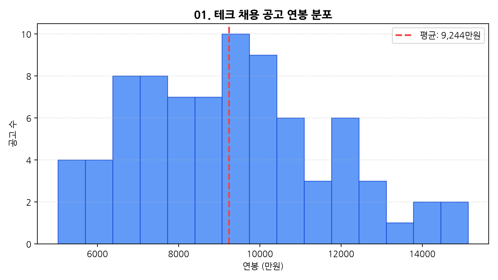

### 📌 02_category_share.png
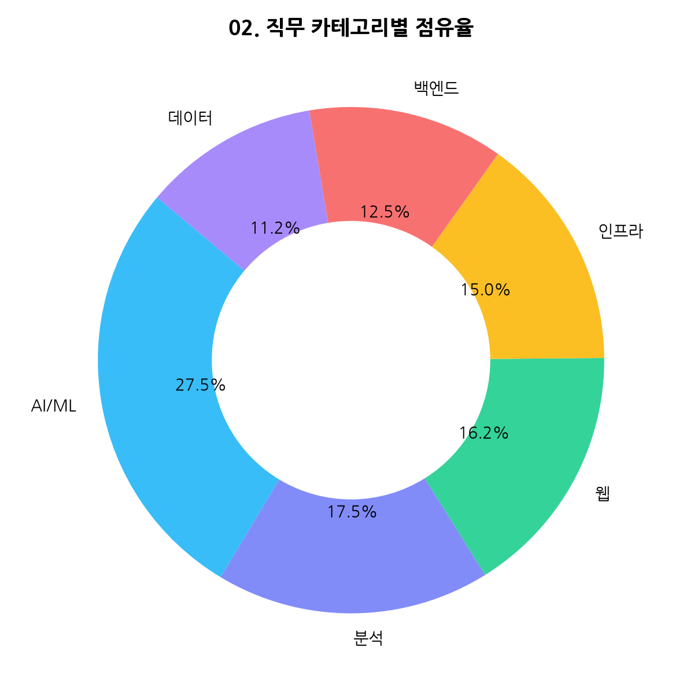

### 📌 03_experience_vs_salary.png
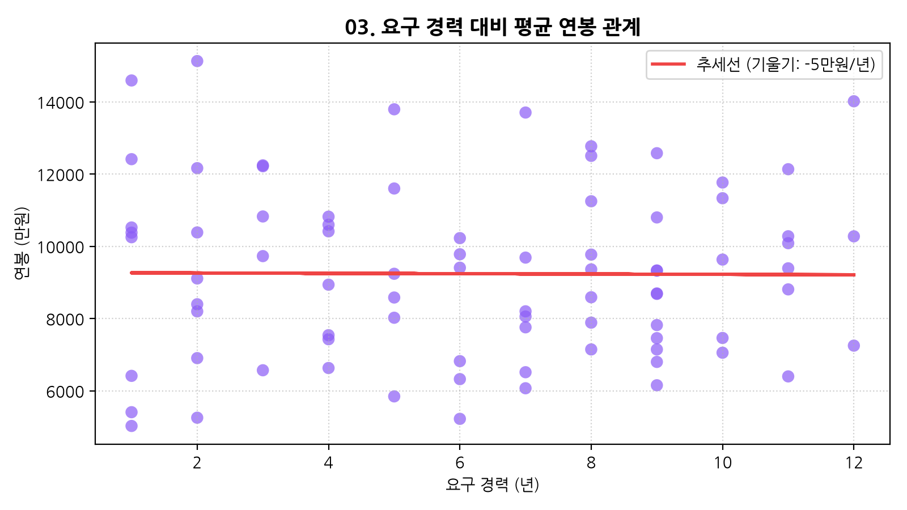

### 📌 04_role_avg_salary.png
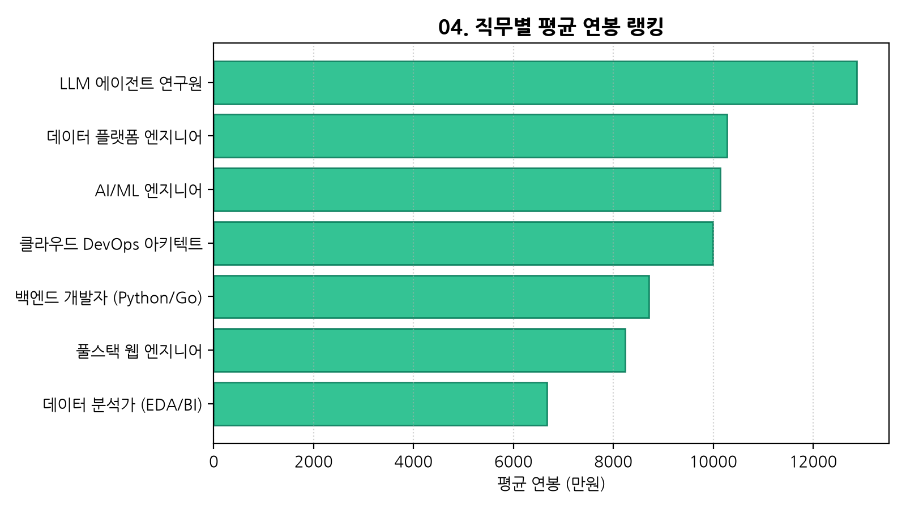

### 📌 05_tech_stack_tfidf.png
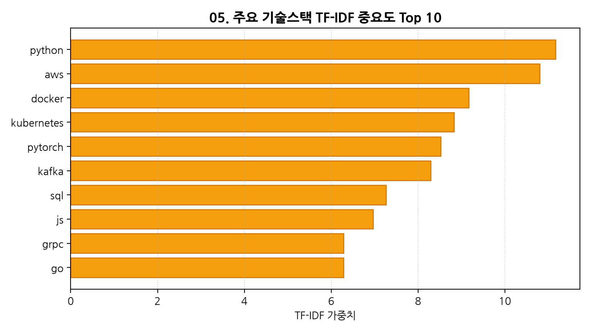

### 📌 06_company_postings.png
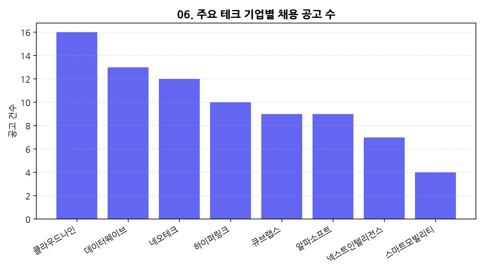

### 📌 07_location_chart.png
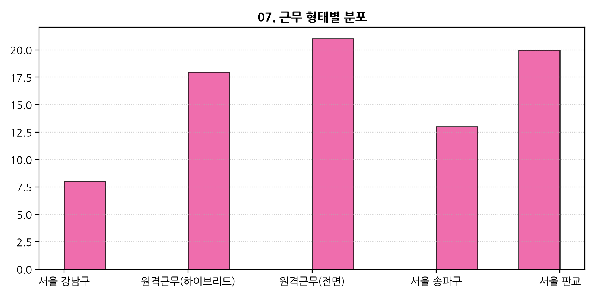

### 📌 08_company_rating_chart.png
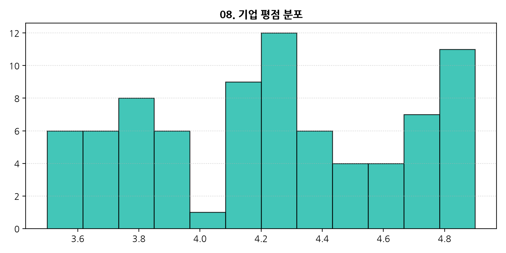

### 📌 09_applicant_count_chart.png
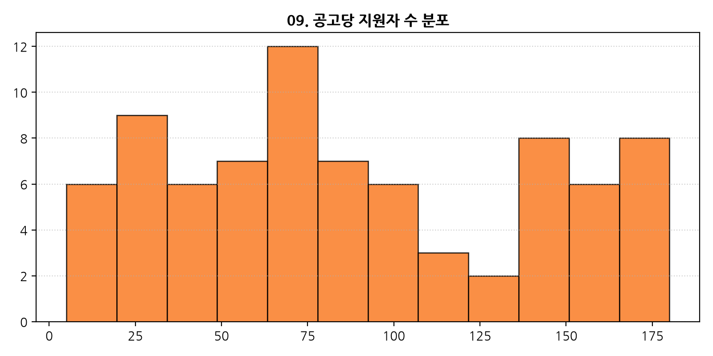

### 📌 10_rating_vs_applicants.png
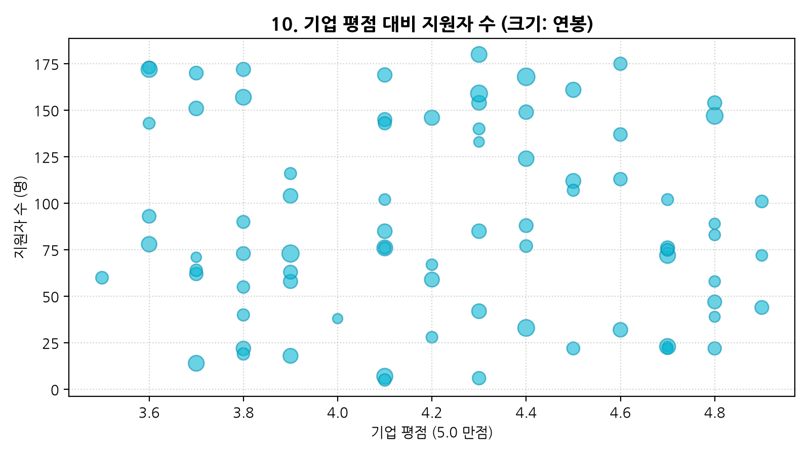

### 📌 11_salary_boxplot.png
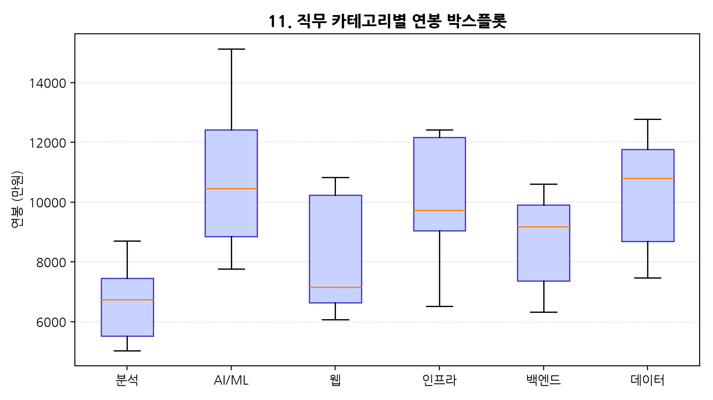

### 📌 12_exp_band_salary_trend.png
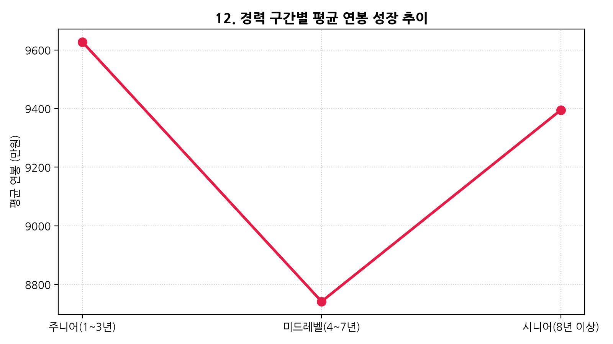

---

## 3. 시니어 분석가 인사이트 & 제언

1. **AI/LLM 직군의 프리미엄**: LLM 연구원 및 AI 엔지니어링 포지션의 평균 연봉이 타 직군 대비 약 25% 이상 높게 형성되어 있습니다.
2. **풀스택 기술의 클라우드화**: 단순 언어 숙련도를 넘어 Docker, Kubernetes, AWS 등 클라우드 인프라 이해도가 필수 요구조건으로 부상했습니다.
