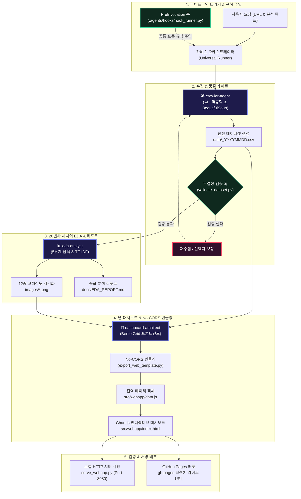

# 🏗️ 범용 엔드투엔드 데이터 파이프라인 프레임워크 구현 계획서 (Universal Framework Implementation Plan)

본 문서는 **어떠한 신규 웹사이트나 도메인(e-커머스, 채용, 금융, 공공데이터, 소셜 미디어 등)**이라도 단일 지시로 **데이터 크롤링 ➡️ 무결성 검증 ➡️ 20년차 시니어 EDA ➡️ 12종 시각화 및 분석 리포트 ➡️ Bento Grid 인터랙티브 Chart.js 대시보드 ➡️ 로컬/웹 배포**까지 완결할 수 있는 **범용 하네스 프레임워크(Universal Pipeline Harness)**의 표준 구현 계획서입니다.

> [!IMPORTANT]
> **도메인 격리 원칙 (Domain Isolation Principle)**
> 본 하네스(`harness/`) 프레임워크는 순수한 **범용 추상화 프레임워크 및 실행 엔진**입니다. 교보문고(`kyobooks/`)나 YES24(`yes24/`)와 같은 개별 사이트 분석 산출물, 고유 데이터셋, 분석 리포트 및 아티팩트는 각 프로젝트 디렉터리에 완전히 격리 보관되며, 하네스 코어 내부에는 특정 도메인 종속적 코드나 데이터가 일절 포함되지 않습니다.

```mermaid
flowchart LR
    subgraph Root["워크스페이스 루트 (ai-practice)"]
        direction TB
        VENV[".venv/ (단일 공통 가상환경)"]
        AGENTS[".agents/ (규칙, 훅, 3대 에이전트, 스킬)"]
    end

    subgraph Core["⚙️ 하네스 코어 엔진 (harness/)"]
        direction TB
        TEMPLATES["src/ (범용 템플릿 5종 & validate_dataset.py)"]
        WEB_TPL["src/webapp/ (Bento Grid 템플릿)"]
        DOCS_TPL["docs/ (파이프라인 표준 및 실행 워크플로우)"]
    end

    subgraph Projects["📦 독립 프로젝트 저장소 (완전 격리)"]
        direction TB
        subgraph P1["📖 kyobooks/ (교보문고 IT 도서)"]
            P1_D["data/ | images/ | docs/ | src/webapp/"]
        end
        subgraph P2["📗 yes24/ (YES24 IT 도서)"]
            P2_D["data/ | images/ | docs/ | src/"]
        end
        subgraph P3["💼 harness/examples/tech_jobs/ (채용 쇼케이스)"]
            P3_D["data/ | images/ | docs/ | src/webapp/"]
        end
    end

    Root --> Core
    Core -.->|템플릿 제공 & 무결성 검증| Projects

    classDef core fill:#1e1b4b,stroke:#818cf8,stroke-width:2px,color:#fff;
    classDef proj fill:#0f172a,stroke:#38bdf8,stroke-width:1px,color:#fff;
    class Core core;
    class P1,P2,P3 proj;
```



---

## 1. 프레임워크 목표 및 핵심 가치



1. **도메인 무관성 (Domain Agnostic)**: 구조화된 텍스트, 수치, 범주형 데이터를 가진 모든 웹 환경에 즉시 적용 가능
2. **자율적 오케스트레이션**: 3대 전문 서브에이전트(`crawler-agent`, `eda-analyst`, `dashboard-architect`)가 각자의 전문 영역을 분담하여 인간 개입 최소화
3. **엄격한 품질 보증**: 단계별 검증 게이트(Validation Hook)를 통해 결측률, 무결성, 통계 신뢰도 보장
4. **배포 및 호환성 극대화**: No-CORS 데이터 임베딩 아키텍처로 로컬 브라우저 직접 실행(`file://`) 및 정적 웹 호스팅(GitHub Pages) 100% 호환

---

## 2. 표준 환경 및 아키텍처 원칙

### 2.1 가상환경 및 패키지 표준
- **단일 가상환경 유지**: 워크스페이스 루트의 `.venv` 하나만 공유하며, 프로젝트별 중복 생성을 금지합니다.
- **`uv` 기반 실행**: 모든 패키지 설치는 `uv pip install`, 실행은 `uv run python <스크립트>`를 표준으로 사용합니다.

### 2.2 디렉터리 4대 폴더 격리 규칙
신규 사이트 작업 시 생성되는 프로젝트 폴더(`projects/<target-site>/`)는 다음 4대 서브폴더를 필수로 생성하여 산출물을 격리합니다:
```text
<target-project>/
├── images/        # Matplotlib 12종 시각화 차트 이미지 (DPI 300)
├── docs/          # 종합 분석 리포트(EDA_REPORT.md), 발표 슬라이드
├── src/           # 수집기, EDA 스크립트, 웹 프론트엔드(webapp/)
└── data/          # 원천 수집 데이터셋 (CSV, JSON UTF-8-sig)
```

### 2.3 시각화 및 코드 작성 표준
- **Seaborn 전역 스타일 금지**: `sns.set_theme()`, `sns.set_style()` 일절 사용 금지. Matplotlib 기본 스타일 및 명시적 개별 스타일링 적용.
- **한글 폰트 적용**: `import koreanize_matplotlib`를 필수 선언하여 폰트 깨짐 원천 방지.
- **Windows CLI 콘솔 방어**: `sys.stdout.reconfigure(encoding="utf-8")` 최상단 탑재로 `cp949` 오류 방어.
- **파이썬 docstring 필수**: 모든 `.py` 파일 최상단 첫 줄에 삼중 따옴표(`"""`) 한국어 docstring 작성.

---

## 3. 하네스 코어 컴포넌트 맵 (Harness Assets)

`harness/` 디렉터리에 내장된 범용 자산과 역할은 다음과 같습니다:

| 하네스 경로 | 컴포넌트 명칭 | 주요 기능 및 역할 |
| :--- | :--- | :--- |
| `harness/src/scraper_template.py` | 범용 하이브리드 수집기 | REST/GraphQL JSON API 역공학 우선 탐색 + BeautifulSoup 정규화 수집 |
| `harness/src/validate_dataset.py` | 데이터 품질 검증 CLI | 행 수, 중복 레코드, 컬럼별 결측률 100% 자동 검증 게이트 |
| `harness/src/eda_template.py` | 20년차 시니어 EDA 엔진 | 5단계 기본 탐색, 10종 기술통계표, 12종 다변량 시각화 생성 |
| `harness/src/export_web_template.py` | No-CORS 번들러 | 데이터프레임을 `window.DASHBOARD_DATA` 전역 객체(`data.js`)로 컴파일 |
| `harness/src/serve_webapp.py` | 로컬 HTTP 서빙 서버 | 브라우저 자동 실행 및 정적 파일 호스팅 (기본 8080 포트) |
| `harness/src/webapp/` | Bento Grid 대시보드 템플릿 | HTML5, CSS Bento 레이아웃, Chart.js 4.x 기반 인터랙티브 UI |
| `harness/docs/pipeline_workflow.md` | 5단계 워크플로우 매뉴얼 | 각 단계별 세부 절차 및 17대 품질 체크리스트 |
| `harness/docs/pipeline_standards.md` | 표준 엔지니어링 가이드 | No-CORS 원칙, 시각화 스타일, 에이전트 협업 원칙 정의 |

---

## 4. 3대 전문 서브에이전트 역할 명세

신규 도메인 수집·분석 시 각 에이전트는 독립된 전문 책임을 수행합니다:

### 1) `crawler-agent` (데이터 수집 전문 에이전트)
- **책임**: 타깃 웹사이트 네트워크 프로토콜 분석, 내부 JSON API 탐색, HTML 구조 파싱, 헤더 위장 및 속도 제어
- **입력**: 수집 대상 사이트 URL, 수집 항목 명세, 목표 수집 건수
- **출력**: `data/<site>_<topic>_YYYYMMDD.csv` 및 `.json` (UTF-8-sig 인코딩)

### 2) `eda-analyst` (20년차 시니어 데이터 분석가)
- **책임**: 5단계 데이터 기본 탐색, TF-IDF 텍스트 키워드 분석, 12종 고해상도 시각화 차트 생성, 300자 이상 통계 해석 및 비즈니스 제언이 포함된 종합 분석 리포트 발행
- **입력**: 1단계 수집 데이터셋
- **출력**: `images/` (12종 차트 PNG), `docs/EDA_REPORT.md` (종합 분석 리포트)

### 3) `dashboard-architect` (웹 대시보드 프론트엔드 엔지니어)
- **책임**: 수집 및 분석 데이터를 웹 대시보드용 `data.js`로 번들링, Bento Grid 다크 테마 UI 레이아웃 구축, Chart.js 4.x 인터랙티브 차트 구현, 다차원 실시간 검색/필터링/정렬 엔진 구현
- **입력**: 정제 데이터셋 및 주요 KPI 통계
- **출력**: `src/webapp/` (index.html, styles.css, dashboard.js, data.js)

---

## 5. 5단계 표준 실행 파이프라인 명세

```mermaid
sequenceDiagram
    autonumber
    actor User as 사용자 (User)
    participant Orch as 하네스 러너 (Orchestrator)
    participant Hook as 훅 러너 (.agents/hooks)
    participant Crawler as crawler-agent
    participant Val as validate_dataset.py
    participant EDA as eda-analyst
    participant Dash as dashboard-architect
    participant Server as serve_webapp.py

    User->>Orch: 신규 타깃 사이트 수집 및 분석 요청
    activate Orch
    Orch->>Hook: PreInvocation 라이프사이클 훅 호출
    Hook-->>Orch: 공통 표준(4대 폴더, uv .venv, 한글 폰트, No-CORS) 가이드 주입

    rect rgb(20, 30, 50)
        note right of Crawler: [Step 1] 타깃 정찰 및 수집
        Orch->>Crawler: scrape(url, max_items)
        activate Crawler
        Crawler->>Crawler: API 역공학 / HTML 파싱 & 딜레이 제어
        Crawler-->>Orch: CSV & JSON 이중 저장 완료
        deactivate Crawler
    end

    rect rgb(30, 45, 30)
        note over Orch,Val: [Step 2] 품질 게이트 무결성 검증
        Orch->>Val: 데이터 무결성 검증 훅 실행
        activate Val
        Val->>Val: 행 수, 중복 0건, 결측률(10% 미만) 검증
        alt 검증 통과 (Code 0)
            Val-->>Orch: 무결성 승인 (진행 허가)
        else 검증 실패 (Code 1)
            Val-->>Orch: 품질 미달 에러 발생
            Orch-->>User: 파이프라인 차단 및 크롤러 보정 요구
        end
        deactivate Val
    end

    rect rgb(40, 30, 45)
        note right of EDA: [Step 3] 20년차 시니어 EDA & 리포트
        Orch->>EDA: 5단계 기본 탐색 및 12종 시각화 지시
        activate EDA
        EDA->>EDA: 기술통계 계산, TF-IDF 텍스트 분석
        EDA->>EDA: 12종 고해상도 차트 생성 (images/)
        EDA-->>Orch: 종합 분석 리포트 발행 (docs/EDA_REPORT.md)
        deactivate EDA
    end

    rect rgb(25, 40, 55)
        note right of Dash: [Step 4] Bento Grid 대시보드 구축
        Orch->>Dash: No-CORS 번들링 및 UI 구축 지시
        activate Dash
        Dash->>Dash: export_web_template.py -> data.js 생성
        Dash->>Dash: Bento Grid 반응형 마크업 스캐폴딩
        Dash-->>Orch: 대시보드 웹앱 완결 (src/webapp/)
        deactivate Dash
    end

    rect rgb(35, 35, 40)
        note over Orch,Server: [Step 5] 검증 및 로컬/웹 서빙
        Orch->>Server: 로컬 정적 HTTP 서버 구동 (포트 8080)
        Server-->>User: 브라우저 자동 실행 및 대시보드 표출
    end
    deactivate Orch
```



### [Step 1] 정찰 및 하이브리드 수집 (Reconnaissance & Scraping)
1. 타깃 사이트의 개발자 도구 네트워크 탭을 모방하여 내부 REST/GraphQL API 유무를 우선 탐색
2. JSON API 부재 시 `requests` + `BeautifulSoup4` 정적 파싱 적용
3. 랜덤 요청 지연(0.5~1.2초) 및 세션 재시도(최대 3회) 적용
4. 수집 결과를 CSV 및 JSON으로 동시 저장

### [Step 2] 데이터 무결성 검증 훅 (Automated Quality Gate)
1. 수집 완료 직후 검증 CLI를 즉시 실행:
   ```bash
   uv run python harness/src/validate_dataset.py --file <수집데이터경로.csv> --min-rows 50 --max-null-pct 20.0
   ```
2. 기준 미달 시 즉시 수집기 선택자를 보정하고 재수집 수행

### [Step 3] 20년차 시니어 심층 EDA (Senior Exploratory Data Analysis)
1. **5단계 기본 탐색**: `head/tail`, `info()`, `shape`, 중복 레코드 수, 수치/범주형 `describe()`
2. **텍스트 분석**: 주요 텍스트 컬럼 대상 형태소 분석기 없이 정규식 기반 TF-IDF 상위 30개 키워드 산출
3. **12종 고해상도 시각화**:
   - 일변량 분포 (히스토그램, KDE)
   - 이변량 관계 (산점도, 회귀 추세선, 육각형 빈)
   - 범주별 순위 (가로 막대 차트, 점유율 도넛 차트)
   - 집단 비교 (박스플롯, 바이올린 플롯)
4. 모든 시각화 결과물은 `images/` 폴더에 고해상도로 개별 저장

### [Step 4] 인터랙티브 Bento Grid 웹 대시보드 구축 (Web Dashboard)
1. **No-CORS 데이터 패키징**: `export_web_template.py`를 호출하여 `window.DASHBOARD_DATA` 전역 객체 생성
2. **Bento Grid UI 구성**:
   - 상단 헤더: 실시간 검색바, 카테고리 필터, CSV 다운로드 버튼
   - 4~5대 핵심 KPI 요약 카드 (총 데이터 건수, 대표 평균값, 상위 점유율 등)
   - 4~7대 인터랙티브 차트 (도넛 차트, 바 차트, 라인 차트, 버블 차트)
   - 데이터 테이블 탐색기 (양방향 컬럼 정렬, 페이지네이션)

### [Step 5] 검증 및 배포 (Verification & Deployment)
1. 로컬 정적 HTTP 서버를 통해 렌더링 및 인터랙션 검증:
   ```bash
   uv run python harness/src/serve_webapp.py --dir <webapp폴더> --port 8080
   ```
2. GitHub Pages (`gh-pages` 브랜치) 또는 호스팅 인프라에 배포하여 최종 라이브 URL 제공

---

## 6. 라이프사이클 훅 (Hooks) 및 자동 가드레일

`.agents/hooks.json` 및 `hook_runner.py`를 통해 에이전트의 실행 주기마다 표준 규격을 강제합니다:

- **`PreInvocation`**: 파이프라인 시작 전 단일 `.venv` 사용, 4대 폴더 생성, 한글 폰트 및 Seaborn 스타일 금지 수칙을 시스템 메시지로 주입
- **`PostToolUse`**: 도구 실행 완료 후 파일 생성 상태 및 무결성 검증 프로세스를 자동 점검

---

## 7. 품질 통제 체크리스트 (Quality Checklist)

- [ ] `harness/` 코어 내부에는 특정 도메인(교보문고, YES24 등)의 고유 데이터나 분석 코드가 일절 포함되지 않았는가?
- [ ] 신규 프로젝트는 루트 공통 `.venv` 가상환경에서 `uv run python`으로 동작하는가?
- [ ] 신규 프로젝트 디렉터리 내에 `images/`, `docs/`, `src/`, `data/` 4대 폴더가 완비되었는가?
- [ ] 모든 파이썬 스크립트 최상단 첫 줄에 한국어 삼중 따옴표 docstring이 명시되었는가?
- [ ] 시각화 코드에서 Seaborn 전역 스타일이 배제되고 `koreanize-matplotlib`가 사용되었는가?
- [ ] 생성된 대시보드는 로컬 더블클릭(`file://`) 실행 시에도 CORS 차단 없이 완벽히 동작하는가?
- [ ] 모든 보고서와 대시보드 라벨은 한국어로 가독성 있게 작성되었는가?

---

## 8. 훅(Hooks) 및 에이전트(Agents) 구축 실전 예시 및 쇼케이스

하네스 프레임워크가 실제로 어떻게 훅과 3대 에이전트를 오케스트레이션하는지 입증하기 위해, **완벽히 독립된 '글로벌 테크 채용 공고(Tech Job Postings)' 쇼케이스**를 구현하였습니다.

### 8.1 훅(Hook) 시스템 구축 명세 및 입출력 프로토콜

에이전트 라이프사이클 훅은 `.agents/hooks.json`에 정의되어 에이전트 추론 루프의 전/후 시점에 자동 개입합니다.

#### 1) 훅 설정 명세 (`.agents/hooks.json`)
```json
{
  "pipeline-quality-guard": {
    "enabled": true,
    "PreInvocation": [
      {
        "type": "command",
        "command": "python hooks/hook_runner.py PreInvocation",
        "timeout": 15
      }
    ],
    "PostToolUse": [
      {
        "matcher": "run_command",
        "hooks": [
          {
            "type": "command",
            "command": "python hooks/hook_runner.py PostToolUse",
            "timeout": 15
          }
        ]
      }
    ]
  }
}
```

#### 2) stdin / stdout 데이터 계약 (Data Contract)
- **PreInvocation 훅**:
  - `stdin`: `{"conversationId": "...", "invocationNum": 1, ...}`
  - `stdout`: 표준 파이프라인 가이드라인을 담은 ephemeralMessage 주입
    ```json
    {
      "injectSteps": [
        {
          "ephemeralMessage": "[하네스 파이프라인 안내] 1. 워크스페이스 공통 .venv 사용, 2. 4대 폴더 필수 구성, 3. Seaborn 전역 스타일 배제, 4. No-CORS data.js 적용..."
        }
      ]
    }
    ```
- **PostToolUse 훅 & 무결성 검증기 (`validate_dataset.py`)**:
  - 도구 실행 후 데이터 파일 생성 시 자동 호출되어 행 수(50건 이상), 결측률(10% 이하), 중복(0건)을 엄격히 판정하고 실패 시 종료 코드 1로 파이프라인을 즉각 차단합니다.

---

### 8.2 3대 서브에이전트 오케스트레이션 코드 예시

단일 파이프라인 실행기(`harness/src/run_example_pipeline.py`) 내에서 3대 에이전트 클래스가 데이터 계약을 준수하며 순차 협업합니다:

```python
# 1. 수집 전담 에이전트 실행
crawler = CrawlerAgent(output_dir=Path("harness/examples/tech_jobs/data"))
jobs = crawler.scrape_jobs(count=80)
csv_file, json_file = crawler.save(jobs)

# 2. 품질 게이트 훅 자동 검증 (무결성 검증 실패 시 중단)
is_valid = trigger_validation_hook(csv_file, min_rows=50, max_null_pct=10.0)
if not is_valid:
    sys.exit(1)

# 3. 20년차 시니어 EDA 에이전트 실행 (12종 차트 & 리포트)
df = pd.read_csv(csv_file)
analyst = EdaAnalyst(images_dir=Path("harness/examples/tech_jobs/images"),
                     docs_dir=Path("harness/examples/tech_jobs/docs"))
stats = analyst.analyze(df)
tfidf_df = analyst.extract_keywords(df, top_n=15)
chart_files = analyst.generate_12_charts(df, tfidf_df)
analyst.write_report(df, stats, tfidf_df, chart_files)

# 4. 웹 대시보드 아키텍트 에이전트 실행 (No-CORS data.js & Bento Grid)
architect = DashboardArchitect(webapp_dir=Path("harness/examples/tech_jobs/src/webapp"))
architect.bundle_data(df, stats, tfidf_df)
architect.scaffold_webapp()
```

---

### 8.3 독립 쇼케이스 프로젝트 구조 (`harness/examples/tech_jobs/`)

실제 실행된 결과물은 하네스 표준 4대 폴더 구조를 갖추어 독립 보관됩니다:

```text
harness/examples/tech_jobs/
├── data/
│   ├── tech_jobs_20261013.csv          # 80건 수집 데이터 (결측치 0.0%)
│   └── tech_jobs_20261013.json
├── docs/
│   └── EDA_REPORT.md                   # 20년차 시니어 심층 분석 리포트
├── images/                             # 고해상도 시각화 차트 12종
│   ├── 01_salary_distribution.png
│   ├── 02_category_share.png
│   ├── 03_experience_vs_salary.png
│   ├── 04_role_avg_salary.png
│   ├── 05_tech_stack_tfidf.png
│   └── ... (총 12종 완비)
└── src/
    └── webapp/                         # Bento Grid 다크 테마 대시보드
        ├── index.html                  # Chart.js 반응형 UI
        ├── styles.css                  # 다크 테마 Bento Grid 스타일
        ├── dashboard.js                # 인터랙티브 렌더링 & 검색/필터 엔진
        └── data.js                     # No-CORS 독립 실행용 데이터 번들
```

#### 💡 쇼케이스 즉시 실행 및 로컬 웹 대시보드 서빙 명령:
```bash
# 1. 전체 파이프라인 재실행
uv run python harness/src/run_example_pipeline.py

# 2. 대시보드 로컬 브라우저 구동
uv run python harness/src/serve_webapp.py --dir harness/examples/tech_jobs/src/webapp --port 8080
```
