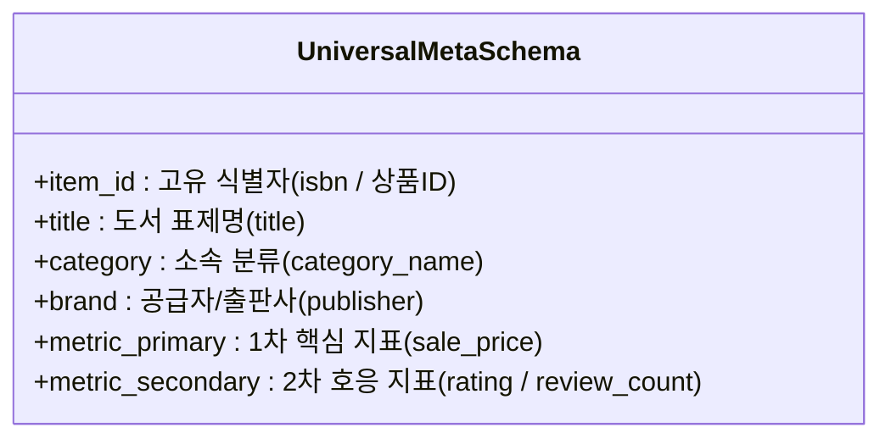

# 📚 [실습 데이터 스키마] 교보문고 IT 베스트셀러 데이터 명세서

본 문서는 교보문고 IT/컴퓨터 베스트셀러 데이터셋의 각 컬럼 정의와 정제 규칙, 그리고 표준 데이터 파이프라인의 **6대 범용 메타 스키마**와의 매핑 관계를 설명합니다.

---

## 1. 수집 데이터 필드 명세 (15개 속성)

| No | 컬럼명 | 데이터 타입 | 설명 | 정제/변환 규칙 | 예시 데이터 |
|:--:|:---|:---:|:---|:---|:---|
| 1 | `rank` | Integer | 베스트셀러 순위 | 정수형 변환 (1부터 시작) | `1` |
| 2 | `title` | String | 도서명 (부제목 포함) | HTML 태그(`<mark>` 등) 제거, 양끝 공백 정돈 | `2026 이지패스 ADsP 데이터분석 준전문가` |
| 3 | `author` | String | 저자 / 역자 | HTML 태그 제거, 다수 저자 시 외 표기 유지 | `박현민 외` |
| 4 | `publisher` | String | 출판사명 | HTML 태그 제거 | `위키북스` |
| 5 | `pub_date` | String | 출간일 | `YYYYMMDD` 형식을 `YYYY-MM-DD` 표준으로 변환 | `2026-01-02` |
| 6 | `original_price` | Integer | 정가 (원) | 쉼표 제거 후 정수형 변환 | `30000` |
| 7 | `sale_price` | Integer | 판매가/할인가 (원) | 쉼표 제거 후 정수형 변환 | `27000` |
| 8 | `discount_rate` | Integer | 할인율 (%) | 도서정가제 기준 보통 10% 내외 | `10` |
| 9 | `rating` | Float | Klover 독자 평점 | 10.0 만점 기준 부동소수점, 미평가 시 `0.0` | `9.86` |
| 10 | `review_count` | Integer | 독자 리뷰 수 | 결측 시 `0` | `395` |
| 11 | `isbn` | String | 13자리 도서 고유번호 | 앞뒤 공백 제거된 문자열 식별자 | `9791158396510` |
| 12 | `category_name` | String | 분야명 | 기본 대분류 (`컴퓨터/IT`) | `컴퓨터/IT` |
| 13 | `category_code` | String | 카테고리 분류 코드 | 교보문고 내부 8자리 분류 번호 | `33280909` |
| 14 | `inbukCntt` | String | 책 소개 및 상세 요약 | ` `, `
`는 줄바꿈(`\n`)으로 보존, 기타 태그 제거 | `미어캣 2026 최신 기출문제 수록 앱 제공...` |
| 15 | `link` | String | 도서 상세 페이지 URL | `https://product.kyobobook.co.kr/detail/{상품ID}` | `https://product.kyobobook.co.kr/detail/S000213...` |

---

## 2. 하네스 파이프라인 6대 범용 메타 스키마 매핑

범용 데이터 파이프라인에서는 서로 다른 사이트(교보문고, YES24, 네이버 등)의 데이터를 표준화하기 위해 아래 **6대 메타 스키마**를 기준으로 추상화합니다.

| 범용 메타 필드 | 교보문고 데이터 매핑 | 설명 및 분석 활용처 |
|:---|:---|:---|
| `item_id` | `isbn` 또는 `saleCmdtid` | 도서 고유 식별 및 중복 제거 검증 기준 키 |
| `title` | `title` | 도서명 검색 및 텍스트 마이닝 |
| `category` | `category_name` | 분야별 분포 비교 |
| `brand` | `publisher` | 출판사별 시장 점유율 및 출판사 성과 비교 |
| `metric_primary` | `sale_price` | 가격 정책, 할인율 분포, 정가-판매가 분석 |
| `metric_secondary` | `rating` / `review_count` | 독자 반응, 품질 만족도 및 평점-리뷰 상관관계 분석 |
