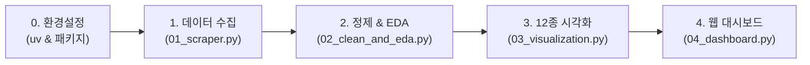

# 📖 [실습 가이드] 교보문고 IT 베스트셀러 데이터 엔지니어링 & EDA 완전 정복

본 가이드는 초보자도 단계별로 따라 할 수 있도록 구성된 **엔드투엔드(End-to-End) 데이터 실습 매뉴얼**입니다.  
**환경설정 ➡️ 데이터 수집 ➡️ 정제 및 기본 탐색 ➡️ 고급 시각화 ➡️ 웹 대시보드 실행** 순서로 차근차근 진행해 보세요!

---

## 🧭 실습 로드맵 (Workflow)



---

## 🛠️ Step 0. 환경설정 (Prerequisites)

### 1) Python 환경 확인
본 실습은 **Python 3.10 이상**을 권장합니다.

```bash
python --version
```

### 2) 빠른 패키지 관리자 `uv` 활용 (권장)
속도가 빠른 `uv`를 사용하면 가상환경 및 패키지 관리가 매우 간편합니다.

```bash
# uv 설치 (미설치 시)
# Windows (PowerShell):
powershell -ExecutionPolicy ByPass -c "irm https://astral.sh/uv/install.ps1 | iex"

# Mac / Linux:
curl -LsSf https://astral.sh/uv/install.sh | sh
```

### 3) 패키지 설치
`student-materials` 폴더 경로에서 아래 명령어를 실행하여 필수 라이브러리를 설치합니다:

```bash
# uv 사용 시 (권장)
uv pip install -r student-materials/requirements.txt

# 일반 pip 사용 시
pip install -r student-materials/requirements.txt
```

---

## 🕷️ Step 1. 데이터 수집 (Web Scraping)

교보문고 공식 REST API 게이트웨이를 호출하여 IT/컴퓨터 분야 베스트셀러 목록을 실시간으로 수집합니다.

### 1) 실습 코드 실행
```bash
# 기본 실행: 상위 5페이지(100권) 수집
uv run python student-materials/src/01_scraper.py --max-pages 5

# 옵션: 전수 수집 (약 600~700권 전체)
uv run python student-materials/src/01_scraper.py
```

### 2) 동작 원리 & 학습 포인트
- **REST API 분석**: 웹 브라우저 개발자도구(F12)의 Network 탭에서 `https://store.kyobobook.co.kr/api/gw/best/best-seller/online` 요청을 발견하고 쿼리 파라미터를 규격화하는 방법을 학습합니다.
- **차단 방지 헤더**: `User-Agent`와 `Referer`를 설정하여 차단을 우회합니다.
- **예의 있는 크롤링**: 서버 부하 방지를 위해 각 페이지 요청 사이에 1초 지연(`--delay 1.0`)을 적용합니다.

### 3) 산출물 확인
- `student-materials/data/kyobo_it_bestsellers_YYYYMMDD.csv`
- `student-materials/data/kyobo_it_bestsellers_YYYYMMDD.json`
*(※ 실습 중 네트워크 이슈가 있더라도 기본 제공되는 `student-materials/data/sample_kyobo_bestsellers.csv`로 이후 단계를 바로 진행할 수 있습니다.)*

---

## 🧹 Step 2. 데이터 정제 및 5단계 EDA 분석

수집된 데이터의 무결성을 검증하고 20년차 시니어 데이터 분석가의 **5단계 기본 탐색 프로세스**를 수행합니다.

### 1) 실습 코드 실행
```bash
# 최신 수집 데이터(또는 샘플 데이터) 자동 로드하여 분석
uv run python student-materials/src/02_clean_and_eda.py

# 특정 파일 지정 실행
uv run python student-materials/src/02_clean_and_eda.py --data-path student-materials/data/sample_kyobo_bestsellers.csv
```

### 2) 5단계 기본 탐색 프로세스
1. **상위 5개 & 하위 5개 행 출력**: 극단값과 데이터 실제 모양새 파악
2. **기본 정보 출력 (`info()`)**: 데이터 타입(Dtype), 메모리 사용량, 결측치 현황
3. **전체 행/열 수 확인 (`shape`)**: 데이터 볼륨 정량화
4. **중복 데이터 검증 (`duplicated()`)**: 고유 식별자 무결성 확인
5. **수치형 & 범주형 기술통계 분리 산출**: 평균, 표준편차, 사분위수, 최빈값

### 3) TF-IDF 키워드 마이닝
형태소 분석기 설치 없이 `scikit-learn`의 `TfidfVectorizer`를 활용하여 책 소개(`inbukCntt`)에서 상위 30대 핵심 기술 키워드를 빠르게 추출합니다.

---

## 📊 Step 3. 12종 고해상도 시각화 차트 생성

단순한 일변량 차트를 넘어 이변량, 다변량, 시계열까지 12가지 각도로 데이터를 시각화합니다.

### 1) 실습 코드 실행
```bash
uv run python student-materials/src/03_visualization.py
```

### 2) 12종 시각화 목록
| 번호 | 분류 | 저장 파일명 | 차트 내용 |
|:---:|:---:|:---|:---|
| 01 | 일변량 | `01_price_distribution.png` | 정가 및 판매가 분포 (히스토그램) |
| 02 | 일변량 | `02_discount_rate_distribution.png` | 할인율 박스플롯 및 구간 빈도 |
| 03 | 일변량 | `03_rating_distribution.png` | Klover 독자 평점 분포 (평균/중앙값) |
| 04 | 일변량 | `04_review_count_log_distribution.png` | 리뷰 수 로그 변환 분포 (`log1p`) |
| 05 | 범주형 | `05_top_publishers.png` | IT 베스트셀러 최다 배출 상위 20대 출판사 |
| 06 | 범주형 | `06_top_authors.png` | 최다 등록 상위 20대 저자/역자 |
| 07 | 텍스트 | `07_tfidf_keywords_top30.png` | 책 소개 기반 TF-IDF 상위 30대 키워드 가중치 |
| 08 | 이변량 | `08_pub_price_vs_rating.png` | 상위 15대 출판사별 평균 판매가 vs 평점 이중 축 |
| 09 | 이변량 | `09_scatter_price_vs_rating.png` | 판매가 vs 평점 산점도 및 추세선 (버블: 리뷰수) |
| 10 | 시계열 | `10_publication_year_trend.png` | 출간 연도별 베스트셀러 진입 추이 (2020년 이후) |
| 11 | 다변량 | `11_correlation_heatmap.png` | 수치형 변수 간 피어슨 상관계수 행렬 |
| 12 | 다변량 | `12_rank_tier_comparison.png` | 순위 구간(Tier)별 판매가 및 평점 비교 박스플롯 |

- 모든 차트는 `student-materials/images/` 폴더에 `dpi=300` 고해상도로 자동 저장됩니다.
- `koreanize-matplotlib`를 사용하여 윈도우/맥/리눅스 어디서나 한글이 깨지지 않습니다.

---

## 🚀 Step 4. 인터랙티브 웹 대시보드 실행 (Streamlit)

Python 코드 몇 줄로 생성된 세련된 웹 대시보드를 로컬 브라우저에서 직접 조작해 봅니다.

### 1) 대시보드 실행
```bash
uv run streamlit run student-materials/src/04_dashboard.py
```

### 2) 웹 브라우저 확인
명령어 실행 시 터미널에 표시되는 로컬 URL(보통 `http://localhost:8501`)로 접속합니다.

### 3) 주요 인터랙티브 기능
- **실시간 검색 & 필터**: 도서명/저자/출판사 실시간 검색, 가격대 슬라이더, 순위 구간 필터
- **출판사 성과 드릴다운**: 상위 출판사별 평균 판매가 및 평점 비교
- **AI/기술 키워드 마이닝**: 실시간 TF-IDF 키워드 추출 시각화
- **반응형 차트**: Plotly를 활용한 툴팁, 줌인/줌아웃 인터랙션

---

## ❓ 자주 묻는 질문 (FAQ) & 트러블슈팅

### Q1. 차트 생성 시 한글이 네모(□)로 깨져서 나옵니다.
- **해결책**: `student-materials/requirements.txt`에 명시된 `koreanize-matplotlib` 패키지가 정상 설치되었는지 확인하세요. 코드 상단에서 `import koreanize_matplotlib`가 실행되면 자동으로 한글 글꼴이 적용됩니다.

### Q2. 스크래핑 실행 시 HTTP 403 Forbidden 오류가 발생합니다.
- **해결책**: 교보문고 사이트 방화벽에서 브라우저가 아닌 비정상 요청으로 감지했을 가능성이 있습니다. `01_scraper.py`의 `DEFAULT_HEADERS`에 최신 `User-Agent`가 설정되어 있는지 확인하고, `--delay` 값을 `1.5` 이상으로 늘려 보세요.

### Q3. Streamlit 실행 시 포트 충돌이 발생합니다.
- **해결책**: 다른 Streamlit 인스턴스가 8501 포트를 사용 중일 수 있습니다. `--server.port 8502` 옵션을 추가하여 실행하세요.
  ```bash
  uv run streamlit run student-materials/src/04_dashboard.py --server.port 8502
  ```
