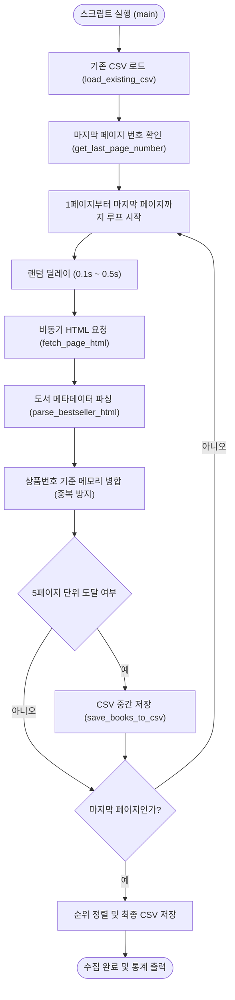

# YES24 베스트셀러 스크래퍼 기술 문서

`scrape_bestseller.py`는 YES24 웹 사이트의 국내도서 종합 베스트셀러 목록을 1페이지부터 마지막 페이지까지 순차적으로 수집하여 CSV 파일로 저장하는 데이터 스크래핑 스크립트입니다.

---

## 1. 개요

- **스크립트 경로**: `yes24/src/scrape_bestseller.py`
- **저장 데이터 경로**: `yes24/data/yes24_bestseller.csv`
- **인코딩**: `utf-8-sig` (Excel 및 타 데이터 도구 호환)
- **수집 대상**: YES24 국내도서 베스트셀러 전체 도서 (카테고리 번호: `001001003`)

---

## 2. 주요 기능 및 특징

1. **마지막 페이지 자동 탐색**
   - 카테고리 메인 페이지의 페이징 네비게이션에서 '끝' 페이지 버튼의 속성(`title`, `onclick`)을 파싱하여 전체 페이지 수를 자동으로 계산합니다. (실패 시 기본 42페이지로 폴백)
2. **비동기 엔드포인트 직접 호출**
   - 웹 브라우저가 목록을 동적으로 불러올 때 사용하는 내부 엔드포인트(`BestSellerContents`)를 직접 호출하여 HTML 조각을 수신하므로 수집 속도가 빠르고 안정적입니다.
3. **안티 크롤링 차단 방지 (Safe Scraping)**
   - 페이지 요청마다 `0.1초 ~ 0.5초` 범위의 무작위 지연시간(Random Delay)을 적용합니다.
   - 실제 브라우저 요청과 동일한 `User-Agent`, `sec-ch-ua`, `Referer` 헤더를 포함합니다.
4. **증분 수집 및 중복 방지 (Incremental Collection)**
   - 기존에 저장된 `yes24_bestseller.csv`가 존재하면, 고유 식별자인 `상품번호`를 기준으로 기존 데이터를 메모리에 적재한 후 신규/갱신 정보를 병합합니다.
5. **체크포인트 중간 저장 (Fault Tolerance)**
   - 5페이지마다 CSV 파일로 자동 중간 저장을 수행하여 장시간 수집 중 네트워크 단절이나 강제 종료 시에도 데이터 유실을 최소화합니다.
6. **순위 기준 자동 정렬**
   - 수집 완료 후 전체 데이터를 1위부터 순위 오름차순으로 정렬하여 저장합니다.

---

## 3. 동작 프로세스 (Workflow)



---

## 4. 수집 데이터 스키마 (CSV 필드 정의)

총 16개의 도서 메타데이터 항목을 추출하여 CSV로 저장합니다.

| 컬럼명 | 타입 | 설명 | 예시 |
| :--- | :--- | :--- | :--- |
| **순위** | 문자열/정수 | 베스트셀러 순위 | `1` |
| **상품번호** | 문자열 | YES24 고유 상품 식별자 (PK) | `194483933` |
| **도서명** | 문자열 | 책 제목 | `클로드 코드 제대로 시작하기` |
| **부제목** | 문자열 | 도서 부제 및 마케팅 설명문구 | `최신 클로드 코드 완벽 반영! ...` |
| **저자** | 문자열 | 저자, 역자, 감수자 정보 | `주홍철, 황진성 저` |
| **출판사** | 문자열 | 발행 출판사명 | `길벗` |
| **출판일** | 문자열 | 출간 연월 | `2026년 08월` |
| **판매가** | 문자열 (숫자) | 할인 판매 가격 (콤마 제외) | `28800` |
| **정가** | 문자열 (숫자) | 도서 정가 (콤마 제외) | `32000` |
| **할인율** | 문자열 | 할인 백분율 | `10%` |
| **평점** | 문자열 (소수) | 회원 리뷰 평점 (10점 만점) | `9.8` |
| **리뷰수** | 문자열 (숫자) | 회원 리뷰 수 | `42` |
| **판매지수** | 문자열 (숫자) | YES24 판매지수 지표 | `88410` |
| **태그** | 문자열 | 관련 키워드 태그 (쉼표 구분) | `클로드, AI에이전트, 개발자필독서` |
| **상세URL** | 문자열 (URL) | 도서 상세 페이지 링크 | `https://www.yes24.com/product/goods/194483933` |
| **이미지URL** | 문자열 (URL) | 도서 표지 대표 이미지 링크 | `https://image.yes24.com/goods/194483933/L` |

---

## 5. 핵심 함수 상세 명세

### 1) `get_last_page_number() -> int`
- **역할**: YES24 국내도서 베스트셀러 메인 페이지(`MAIN_PAGE_URL`)를 요청하여 HTML 내 페이징 네비게이션 '끝' 버튼의 `title` 또는 `onclick` 속성에서 총 페이지 수를 추출합니다.
- **예외 처리**: 요청 실패나 페이지 파싱 불가 시 기본값 `42`를 반환합니다.

### 2) `load_existing_csv(csv_path: str) -> Dict[str, Dict[str, Any]]`
- **역할**: 기존 저장된 CSV 파일이 존재하면 읽어 `상품번호`를 키로 하는 딕셔너리로 반환합니다.
- **특징**: `utf-8-sig` 인코딩을 적용하여 Excel과의 호환성을 유지합니다. 파일이 없으면 빈 딕셔너리를 반환합니다.

### 3) `fetch_page_html(page_number: int) -> Optional[str]`
- **역할**: 특정 페이지의 도서 목록을 수신하기 위해 `BASE_URL`(`BestSellerContents`)로 파라미터(`categoryNumber`, `pageNumber`, `pageSize` 등)와 헤더(`User-Agent`, `Referer`)를 구성하여 HTTP GET 요청을 전송합니다.
- **반환값**: 성공 시 응답 HTML 텍스트, 실패 시 `None`.

### 4) `parse_bestseller_html(html_text: str) -> List[Dict[str, Any]]`
- **역할**: BeautifulSoup으로 `li[data-goods-no]` 요소들을 순회하며 각 도서의 16개 메타데이터 항목을 파싱합니다.
- **특징**:
  - `ORD_GOODS_OPT` 히든 input 태그의 JSON 데이터를 함께 분석하여 결측치(가격, 저자 등)를 보정합니다.
  - 지연 로딩되는 이미지는 `data-original` 속성을 우선 추출합니다.
  - 가격과 판매지수 내 쉼표(`,`)를 제거하여 데이터 분석 시 수치형 변환이 용이하도록 정제합니다.

### 5) `save_books_to_csv(books: List[Dict[str, Any]], output_path: str) -> None`
- **역할**: 도서 딕셔너리 리스트를 순위(`순위`)를 기준으로 오름차순 정렬한 뒤 지정된 CSV 파일로 저장합니다.
- **특징**: 상위 폴더가 없으면 자동 생성(`os.makedirs`)하며 일관된 컬럼 순서로 작성합니다.

### 6) `main() -> None`
- **역할**: 전체 스크래핑 프로세스를 제어합니다.
- **흐름**: 기존 데이터 로드 → 마지막 페이지 탐색 → 페이지 루프(랜덤 슬립, 요청, 파싱, 병합, 5페이지마다 중간 저장) → 최종 정렬 저장 및 결과 출력.

---

## 6. 실행 방법

프로젝트 루트 디렉터리에서 `uv` 가상환경을 사용하여 실행합니다.

```bash
# 베스트셀러 스크래퍼 실행
uv run python yes24/src/scrape_bestseller.py
```

실행 시 콘솔에 다음과 같이 진행 상황이 실시간으로 출력됩니다:

```text
[확인] 기존 CSV 파일이 없습니다. 새 파일로 생성합니다: yes24\data\yes24_bestseller.csv
[수집 계획] 1페이지부터 42페이지까지 수집을 진행합니다.
[01/42 페이지] 수집 도서: 24권 (신규 추가: 24권, 대기시간: 0.32초)
[02/42 페이지] 수집 도서: 24권 (신규 추가: 24권, 대기시간: 0.18초)
...
[05/42 페이지] 수집 도서: 24권 (신규 추가: 24권, 대기시간: 0.45초)
...
==================================================
[수집 완료] 총 1008권의 도서 정보가 저장되었습니다.
[신규 추가] 이번 실행으로 추가/갱신된 신규 도서: 1008권
[저장 경로] yes24\data\yes24_bestseller.csv
==================================================
```
